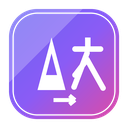

<p align="center">
  
</p>

<h1 align="center">EasyTranslate · macOS 菜单栏工具箱</h1>

<p align="center"><a href="#中文">中文</a> · <a href="#english">English</a></p>

---

## 中文

> 翻译 · JSON · 编码 · 密码 · 验证码 · 截图标注，常驻 macOS 菜单栏，一个快捷键随叫随到。

v3 是一次完全重写：主进程模块化，窗口预热，界面改为原生风格并跟随系统深色模式，功能也做了补全。

### 功能

| 功能 | 说明 |
| --- | --- |
| 翻译 | 输入即翻译（支持 9 种语言，自动识别）、朗读、⌘↩ 复制译文、历史记录；**划词翻译** ⌘⇧Y 可在任意应用中使用 |
| JSON | 弹窗内快速格式化 / 压缩 / 转义，⌘↩ 格式化，可定位错误行列；支持多层转义 JSON 自动解包 |
| JSON 工作台 | CodeMirror 编辑器 + 按需渲染的树形视图（大文件也流畅），键名排序、搜索定位、路径复制、打开 / 拖入 / 保存文件、窗口置顶 |
| 编码 | Base64（含 URL 安全）/ URL / Unicode / HTML 实体实时互转，时间戳转换，SHA-1/256/512 哈希 |
| 密码 | 加密安全随机数（无偏差），保证每类字符至少出现一次，可排除易混淆字符，熵值强度显示，候选列表，选项自动记忆 |
| 验证码（TOTP） | 粘贴二维码图片 / 框选屏幕扫码 / 手动输入密钥；**支持 Google Authenticator 导出的批量迁移二维码**；搜索、拖拽排序、备注、改名；数据由系统钥匙串加密保存 |
| 截图 | 秒开（覆盖层预热 + 原生 `screencapture`），悬停自动识别窗口，矩形 / 椭圆 / 箭头 / 画笔 / 马赛克 / 文字 / 序号标注，放大镜取色（⌘C 复制色值），识别二维码，复制 / 保存 / 钉在屏幕上 |
| 钉图 | 拖动移动、滚轮缩放、右键复制 / 保存、双击或 Esc 关闭 |
| 设置 | 自定义全局快捷键（冲突检测）、开机自启、外观、中文默认译入语言、自动复制译文、权限状态一览 |

### 快捷键

| 全局 | |
| --- | --- |
| ⌘⇧T | 显示 / 隐藏主窗口（出现在鼠标所在屏幕） |
| ⌘⇧Y | 划词翻译 |
| ⌘⇧Z | 截图 |

| 主窗口 | | 截图 | |
| --- | --- | --- | --- |
| ⌘1 – ⌘5 | 切换功能 | 1 – 7 | 切换标注工具 |
| ⌘, | 设置 | ↩ / 双击选区 | 复制并退出 |
| ⌘↩ | 复制译文 / 格式化 JSON | ⌘S | 保存 |
| Esc | 隐藏窗口 | ⌘Z | 撤销 |
| | | 方向键 | 微调选区（⇧ 10px，⌘ 调整大小） |
| | | 右键 | 重新选择 / 退出 |

全局快捷键均可在「设置」中修改。主窗口右上角 📌 可固定窗口，失焦时不再自动隐藏。

### 权限

- **屏幕录制**：截图需要。首次截图时系统会提示，授权后重新打开应用。
- **辅助功能**：划词翻译需要（用于发送 ⌘C 读取选中文字）。

设置页会显示两项权限的当前状态，并提供一键跳转。

### 开发

```bash
npm install
npm run dev     # Vite + Electron（自动注入开发地址）
npm test        # node:test 单元 / 结构测试
npm run build   # 构建渲染进程
npm run dist    # 打包 universal dmg（需在 macOS 上执行）
```

> npm 11 默认不执行依赖的安装脚本，若 `npm run dev` 提示找不到 Electron，可执行 `node node_modules/electron/install.js` 下载 Electron 运行时。

### 项目结构

```
electron/
  main.js        入口：托盘、应用菜单、IPC、启动流程
  windows.js     菜单栏弹窗（常驻预热）与工作台窗口
  capture.js     截图：screencapture 抓屏、窗口识别、覆盖层、钉图
  selection.js   划词读取（异步，保留并恢复剪贴板）
  shortcuts.js   全局快捷键注册 / 冲突检测
  translator.js  翻译服务（主进程 net.fetch，走系统代理，LRU 缓存）
  clipboard.js   剪贴板封装
  store.js       JSON 存储（防抖原子写入，自动导入 v2 数据）
  vault.js       验证码账号加密存储（safeStorage）
  preload.cjs    sandbox 预加载，IPC 白名单
src/
  core/          纯函数：语言、JSON、编码、密码、TOTP（Node 测试直接覆盖）
  ui/            设计系统、图标、通用组件、二维码识别
  popup/         菜单栏弹窗（翻译 / JSON / 编码 / 密码 / 验证码 / 设置）
  workspace/     工作台（CodeMirror 编辑器 + 树视图 + 编码）
  capture/       截图标注覆盖层
  pin/           钉图窗口
scripts/         dev 启动脚本与测试
build/           打包后签名脚本
resources/       图标、托盘图标、entitlements
```

### 技术栈

Electron 45 · Vite 8 · CodeMirror 6 · jsQR · 原生 Canvas 标注 · macOS `screencapture` / CGWindowList（JXA）。

---

## English

> Translate · JSON · Encoders · Passwords · 2FA codes · Screenshot annotation — in your macOS menu bar.

v3 is a ground-up rewrite with a modular main process, pre-warmed windows, a native-looking UI that follows system dark mode, and a more complete feature set:

- **Translate**: translate-as-you-type across 9 languages with auto-detect, text-to-speech, history, and **selection translate** (⌘⇧Y) from any app.
- **JSON**: quick format / minify / escape in the popup, plus a workspace window with a CodeMirror editor, a lazily rendered tree view, key sorting, search, path copy, and file open/save.
- **Encoders**: live Base64 (incl. URL-safe), URL, Unicode, and HTML entities, along with timestamp conversion and SHA hashes.
- **Passwords**: unbiased crypto RNG with guaranteed character classes, an entropy-based strength meter, and remembered options.
- **2FA (TOTP)**: add by pasting a QR image, scanning the screen, or entering a secret manually, and **import Google Authenticator migration QR codes**. Accounts are encrypted with the system keychain.
- **Screenshot**: opens instantly via a pre-warmed overlay and native `screencapture`, auto-detects windows, and supports 7 annotation tools, a color picker, QR decoding, and copy / save / pin-to-screen.
- **Settings**: customizable global shortcuts with conflict detection, launch at login, appearance, and permission status.

Run `npm install`, then `npm run dev` / `npm test` / `npm run dist` (packaging requires macOS).
